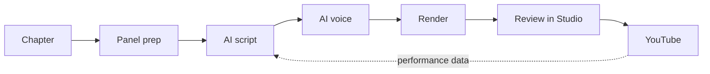
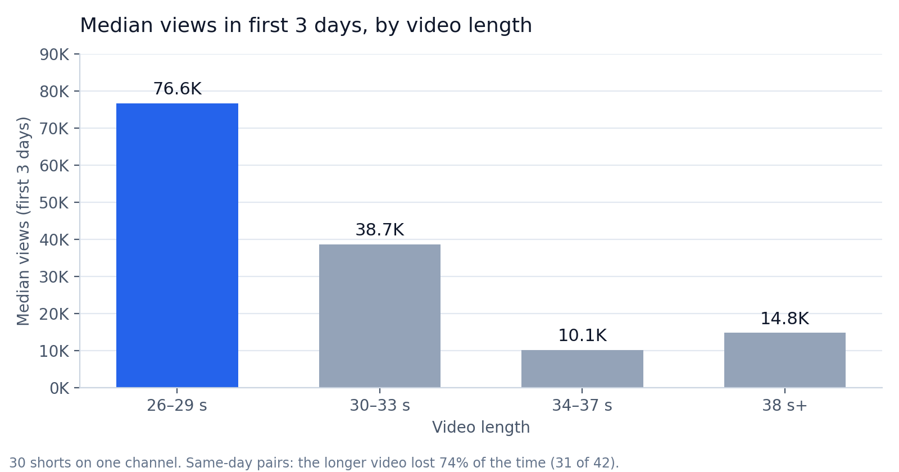

# Shorts Studio

**An AI pipeline that turns webcomic chapters into narrated, captioned YouTube Shorts, end to end.**

| ~$2,000 / month | 3 channels | 170+ shorts | 2 languages |
| :---: | :---: | :---: | :---: |
| revenue | run from one app | published and tracked | English and Spanish |

<!-- Demo: record ~25 s of the Studio (pick panels → script → render → play) and save it as assets/demo.gif, then uncomment:

-->

> The full source is private. This repo is a case study of what it does and what came out of it.
> Happy to walk through the code in an interview.

---

## What it does

Hand it a chapter and it gives back a finished vertical short, ready to upload:

1. **Panel prep:** pulls the chapter's art, splits it into panels and upscales them for vertical video.
2. **AI script:** an LLM writes a short narration in the channel's voice and style.
3. **AI voice:** narration is voiced with a cloned voice, in English or Spanish.
4. **Render:** panels, voice, captions, music and effects are cut together into a 9:16 video.
5. **Review:** every short lands in a web app where I approve, redo or skip it.
6. **Feedback loop:** YouTube performance data flows back in and shapes how future shorts are made.

## Shorts Studio (the web app)

A local web app that runs the whole thing from a phone or a laptop:

- Start a short, watch it render live, and approve or redo it
- Full history of every short made, with its script and result
- Autopilot mode that makes shorts with no manual steps
- Per-channel settings for voice, language and style

<!-- Screenshots: add assets/studio-*.png (blur channel names first), then list them here. -->

## Results

Retention data from the YouTube Analytics API showed that video length mattered more than anything else I had tested.

- **26–29 s shorts got about 2× the median views** of 30–33 s shorts (76.6K vs 38.7K in the first 3 days).
- Compared only against videos published **on the same day**, the longer video lost **31 of 42 times (74%)**, so the effect isn't explained by video age.
- I retuned the pipeline to target that length band.

## What I built

- **End-to-end automation**, from raw chapter to published video, in about 28K lines of Python and JavaScript
- **LLM integration** that writes scripts in a consistent house style and improves from past approved scripts
- **Local voice cloning**, replacing a paid text-to-speech dependency
- **Computer vision and media processing:** panel detection, AI upscaling, video rendering
- **Analytics:** OAuth access to YouTube data, and length experiments designed to avoid survivorship bias
- **Cross-platform:** runs on Windows and macOS

## Tech stack

**Python** · **JavaScript** · **Flask** · **Claude API** · **YouTube Data & Analytics APIs (OAuth 2.0)** · **ffmpeg** · **Real-ESRGAN** · **Whisper** · **local TTS / voice cloning** · **matplotlib**

---

Built by [Nevan Le](https://github.com/Nexan101) · [Portfolio](https://nexan101.github.io/NevanLandingPage.github.io/)

© 2026 Nevan Le. All rights reserved. No license is granted to copy or reuse this material.
